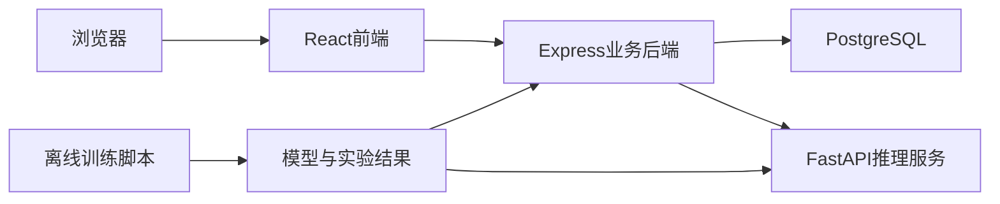

# 软件问题工单分类与辅助分流系统实施计划

依据 [software_issue_project_tasks.md](software_issue_project_tasks.md)。仓库目前只有这份计划，从零搭建。界面采用已确认的**浅色工单工作台**。第一版不做登录、反馈再训练、中文工单正文、自动回复和相似工单检索。

课程报告 Word 模板和项目说明 PDF 不在仓库里。T8 里的报告、VeriGuide 和演示视频等模板到位后再做；本计划先交付可启动的软件、实验产物和部署说明。

## 已拍板的产品规则

- 一个通用三分类器，标签为 `bug` / `feature` / `question`。按五个仓库分别报告指标：`facebook/react`、`tensorflow/tensorflow`、`microsoft/vscode`、`bitcoin/bitcoin`、`opencv/opencv`。这与竞赛“每个仓库单独训练”不同，在 README 里写明。
- 官方测试集只在方案固定后评估一次。验证集从官方训练集按「仓库 + 标签」分层划出 20%，`random_state=42`。
- 队列由规则决定，不由模型直接预测：`bug` → 缺陷处理，`feature` → 功能需求，`question` → 技术支持。最高类别分数低于阈值时，队列为人工复核。
- 复核状态使用三档，避免把未人工看过的工单标成「已确认」：`auto` 自动分流、`pending` 待复核、`confirmed` 已确认。文档里的两档是人工复核流程；`auto` 只表示高置信、尚未人工处理。
- 模型预测行只追加、不覆盖。人工确认或纠正只写确认类别并改队列。分类失败仍保存工单，状态为分类失败，队列为空，可重试。
- 阈值规则（验证集，不看测试集）：在 0.40–0.95、步长 0.05 上扫描。选取「自动分流样本准确率 ≥ 0.90」的最低阈值；若没有这样的点，则在复核比例 ≤ 40% 的点里取自动分流准确率最高者。结果写入配置，并在实验页说明分数不是已验证正确率。
- 人工反馈导出为 CSV。纠错记录只导出，不自动加入训练集。

## 架构

目录：

- [frontend/](frontend/) React + TypeScript + Vite + Ant Design + ECharts
- [backend/](backend/) Express + TypeScript
- [model_service/](model_service/) FastAPI
- [training/](training/) 数据、基线、DistilBERT、实验产物
- [docs/](docs/) 表结构、接口、数据说明
- [docker-compose.yml](docker-compose.yml)、[.env.example](.env.example)、[README.md](README.md)

模型权重和原始 CSV 不进 Git。大模型只保留下载说明和本地路径。

## 数据与训练

数据来自 [NLBSE 2024](https://github.com/nlbse2024/issue-report-classification)，字段 `Repository, Label, Title, Body`。脚本保存原始文件、来源和许可证说明，检查缺失、重复、跨划分重复和长度。

文本方案：

- 标题 + 正文：`title + "\n\n" + body`
- 长文本：Transformer 按选定 `max_length` 截断；TF-IDF 侧正文截到 10000 字符，与推理一致
- 清理方案（仅预处理对比实验）：去掉 fenced code、堆栈/日志行，再折叠空白

阶段 A 先完成基线：训练集拟合 TF-IDF（词 1–2 gram）+ 逻辑回归，验证集选 `C`。保存向量器、模型、标签映射。输出 Macro-F1、各类 P/R/F1、准确率、混淆矩阵、误判样本、单条推理耗时。

阶段 C 使用 `distilbert/distilbert-base-uncased`，微调整个编码器和三分类层。种子 42。在验证集上比较 `max_length` 128 与 256、训练曲线，并确定复核阈值。三组实验：

- 逻辑回归 vs DistilBERT（标题 + 正文，同一预处理）
- 仅标题 vs 标题 + 正文
- 保留代码/日志 vs 清理代码/日志

主指标 Macro-F1，同时报告各类指标、准确率、推理耗时和分仓库 Macro-F1。测试集只评估最终固定方案。若基线更好，实验页按真实结果展示，不改数字。产物落到 `training/results/`，供 `GET /api/model-results` 读取。Mac 上优先用 MPS，没有则用 CPU；epoch 控制在 3–4，batch 16，学习率 2e-5。

## 数据库

- `tickets`：项目、标题、正文、处理状态（pending / in_progress / resolved）、分类状态（pending / classified / failed）、复核状态（auto / pending / confirmed）、当前预测类别、当前确认类别、当前队列、备注、时间
- `predictions`：模型版本、三类分数、最高分、所用阈值、当时队列、是否当前预测。重试新增行，旧行保留
- `reviews`：确认或纠正、确认类别、纠正前类别、备注、时间
- `ticket_events`：创建、分类成功/失败、重试、状态、备注、确认、纠正、队列变化

## 接口

业务 API 前缀 `/api`。Express 调 FastAPI，超时 8 秒；失败不回滚工单。

- `POST /api/tickets`：`{ project, title, body }` → 工单 + 预测或分类失败原因
- `GET /api/tickets`：关键词（标题/正文）、项目、预测类别、确认类别、队列、处理状态、复核状态、分类状态、分页
- `GET /api/tickets/:id`：详情、当前预测、全部预测历史、确认记录、操作记录
- `PATCH /api/tickets/:id`：处理状态、备注
- `POST /api/tickets/:id/review`：`confirm` 或 `correct` + 类别。纠正后按确认类别重算队列，预测分数不变
- `POST /api/tickets/:id/retry-classification`
- `GET /api/stats`：可按项目和时间筛选
- `GET /api/model-results`：只读离线 JSON
- `GET /api/feedback/export`：反馈 CSV
- FastAPI `POST /predict`、`GET /health`

校验用 zod：项目必须是五个仓库之一；标题 1–200 字；正文 1–20000 字。空标题在模型服务返回 422。

## 前端样式

中文界面，`antd` 语言包 `zhCN`。标题和正文提示「请使用英文，与训练数据一致」，不拦截其他字符。数据请求用页面内 fetch，不用额外状态库。

主题令牌写在 [frontend/src/theme.ts](frontend/src/theme.ts)：

- 主色 `#1677ff`，布局底 `#f5f7fa`，容器白底，圆角 8
- 字体：`PingFang SC`, `Noto Sans SC`, `Segoe UI`, sans-serif
- 侧栏宽 216、白底、右边线 `#f0f0f0`；选中项底 `#e6f4ff`
- 顶栏高 56、白底：左侧页面标题，右侧模型健康 Tag（健康 / 不可用）
- 内容区内边距 24。宽度小于 992px 时侧栏收成抽屉
- 卡片白底、1px `#f0f0f0` 边，不用重阴影

固定语义色，全站共用 `LabelTag`、`QueueTag`、`ScoreBars`：

- bug `#cf1322`，feature `#1677ff`，question `#389e0d`
- 待复核 `#d48806`，行底 `#fffbe6`
- 分类失败用错误色 Tag；自动分流用默认灰 Tag

分数条：左侧类别名 72px，中间条，右侧一位小数百分比。条下固定说明：「分数为模型输出的类别概率，不是已验证的正确率。」

预测和人工结果必须分成两块：

- 「模型预测」：中性边框，副文案「纠错后仍保留原始预测」
- 「人工确认」：实线边框；没有确认时显示「尚未人工确认」

业务统计页顶栏 Tag「业务数据」。实验页顶栏 Tag「离线实验」。两页不共用同一组数字。

加载用 `Skeleton` / 按钮 `loading`；空列表用 `Empty` 并引导去提交；失败用 `Alert` + 重试；成功用 `message.success`。

五个页面：

- `/submit` 提交工单。宽 800 的卡片：项目下拉、标题、正文（8 行）。按钮：填充示例、清空、提交。示例为三条英文（缺陷、功能、咨询）。提交后在同页结果区展示类别、三条分数、队列。低置信出琥珀 `Alert`「已进入人工复核」；模型失败出错误 `Alert`「工单已保存，分类失败」，并链接到详情。
- `/tickets` 工单列表。筛选条 + `middle` 表格：编号、项目、标题、预测、确认、最高分、队列、处理状态、复核、分类、创建时间。待复核行用琥珀底。行点击进详情。服务端分页。
- `/tickets/:id` 详情。正文 `pre-wrap` 保留代码格式。右侧为预测块、分数条、模型版本和阈值；下方人工确认/纠正、处理状态下拉、备注、重试分类。底部 `Timeline` 操作历史。
- `/stats` 统计。四张概览卡：总数、待复核、分类失败、纠错数。ECharts：类别分布、队列分布、处理状态、提交趋势。筛选项目与日期。按钮导出反馈 CSV。
- `/experiments` 实验。数据分布、训练/验证曲线、混淆矩阵热力图、三组实验指标、分仓库 Macro-F1、误判样本、最终模型与阈值选择理由。数值只来自 `training/results`。页面不提供训练按钮。

## 实施顺序

与文档阶段一致。每阶段结束要能按 README 启动，并留下该阶段的运行结果。

- 阶段 A：目录、`.env.example`、表结构与接口文档、Compose 里的 Postgres；下载并固定数据划分；跑通基线，使一条标题+正文能输出三类分数。
- 阶段 B：FastAPI 先加载基线；Express 完成工单闭环；前端完成提交、列表、详情，并在浏览器走通高置信分流、低置信复核、纠错、分类失败与重试。
- 阶段 C：三组实验和 DistilBERT；推理服务换成选定模型；补统计页、实验页和反馈导出。预测与离线脚本对同一输入一致。
- 阶段 D：Compose 编排四个服务，重启后数据仍在；准备覆盖三类、复核、纠错、分类失败的演示工单；完善 README。报告、视频、VeriGuide 和 Blackboard 入口依赖课程模板，模板到齐后再单独做。
